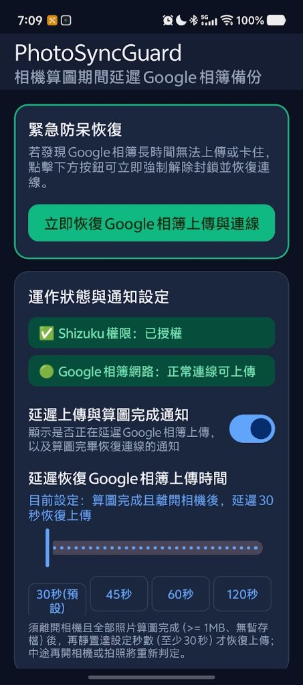
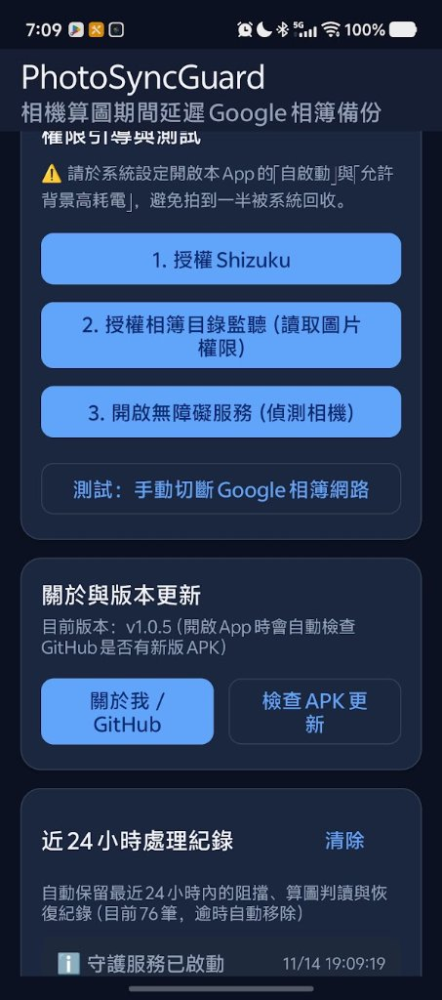
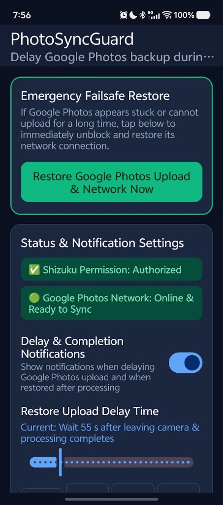
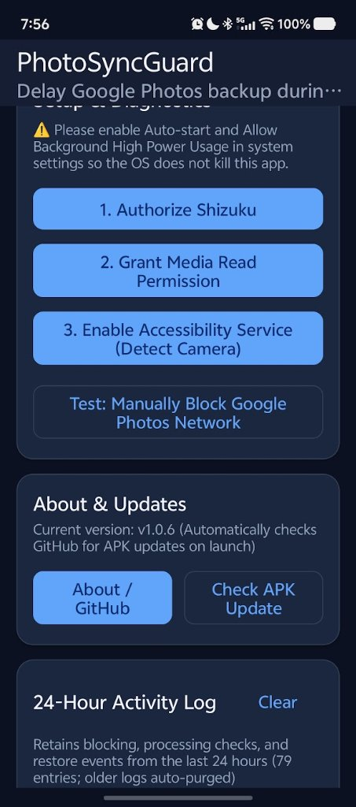

# PhotoSyncGuard

> **📢 專案狀態 / Project Status：最終版（Final Release）**
> 本專案已發佈最終版本，後續將不再進行功能更新與維護。  
> This project has reached its final release and is no longer actively updated or maintained.

[繁體中文](#繁體中文說明) | [English](#english-description)

---

## 介面預覽 / Screenshots

| 繁體中文（主畫面與狀態控制） | 繁體中文（權限引導與 24 小時紀錄） |
| :---: | :---: |
|  |  |

| English (Main & Controls) | English (Setup & 24h Logs) |
| :---: | :---: |
|  |  |

---

## 繁體中文說明

> **⚠️ 重要說明：免 Root，但必須使用 Shizuku（No Root Required, Shizuku Mandatory）**
> - **完全免 Root**：無需解鎖 Bootloader 或取得手機 Root 權限。
> - **必須搭配 Shizuku**：本 App **必須安裝並啟動 [Shizuku](https://shizuku.rikka.app/) 服務且完成授權**，才能透過系統級權限切斷／恢復 Google 相簿網路連線；未啟動 Shizuku 將無法運作。

### 專案目的
專為 **OPPO（ColorOS）、vivo（OriginOS / FuntouchOS）與小米（HyperOS）的全球版及中國版 ROM** 打造的免 Root Android 守護工具。

> **系統版本備註**：**vivo 國際版 OriginOS 7（基於 Android 17）** 已於系統層內建修復此問題，使用此版本系統的使用者可忽略安裝本工具。

解決手機在進行多幀合成、HDR 或夜景算圖時，**Google 相簿過早抓取並上傳未算圖完成的低畫質預覽圖（半成品），且在手機完成最終高品質成片覆寫後，Google 相簿不會再次觸發重新上傳**的問題。

### 核心機制
1. **Shizuku 系統級動態斷網**：偵測到相機開啟或 `/DCIM/Camera/` 產生暫存檔 / `< 1MB` 未算完照片時，透過 Shizuku 暫時切斷 Google 相簿（`com.google.android.apps.photos`）的網路連線（不佔用 VPN 通道）。
2. **1MB 成片門檻與安全兜底**：待照片算圖完成並覆寫為 `>= 1MB` 且離開相機 **5 秒**後自動恢復聯網，讓 Google 相簿直接備份最終完整成片；若遇到極端小圖（`< 1MB`），離開相機且無寫入達 **35 秒**後也會自動恢復連線。
3. **緊急防呆與 24 小時紀錄**：主畫面頂部提供一鍵強制恢復連線的防呆按鈕、可開關的延遲上傳／算圖完成通知，以及自動保留近 24 小時的處理紀錄（逾時自動清除）。
4. **固定簽名**：內建固定簽章金鑰，後續更新 APK 可直接覆蓋安裝，無需移除舊版。

---

## English Description

> **⚠️ Important: No Root Required, Shizuku Mandatory**
> - **100% Rootless**: No bootloader unlock or root access needed.
> - **Shizuku Required**: You **must install, start, and authorize [Shizuku](https://shizuku.rikka.app/)** so PhotoSyncGuard can dynamically block/restore network access for Google Photos. Without Shizuku, this app cannot function.

### Purpose
A rootless Android companion app built for **OPPO (ColorOS), vivo (OriginOS / FuntouchOS), and Xiaomi (HyperOS) — both Global and CN ROMs**.

> **OS Note**: **vivo Global ROM OriginOS 7 (Android 17)** already includes a built-in fix for this issue—users on OriginOS 7 Global can skip this app.

It solves the issue where **Google Photos prematurely grabs and backs up unfinished low-resolution preview photos during multi-frame / HDR / Night computational photography, and fails to re-upload the final full-quality photo after the camera engine finishes processing and overwrites the file**.

### How It Works
1. **Dynamic Network Guard via Shizuku**: When the camera is in the foreground or temporary / `< 1MB` preview files appear in `/DCIM/Camera/`, PhotoSyncGuard temporarily blocks network access for Google Photos (`com.google.android.apps.photos`) without occupying a VPN slot.
2. **1MB Completion Threshold & Safety Timeout**: Once the photo is overwritten with a finished `>= 1MB` image and you leave the camera for **5 seconds**, network access is restored so Google Photos uploads only the final shot. A **35-second** idle safety timeout prevents permanent blocking on unusually small photos.
3. **Failsafe Restore, Notifications & 24h Logs**: Features a top-level emergency failsafe button to immediately restore Google Photos connectivity, a user-toggleable status notification, and a 24-hour auto-pruning activity log.
4. **Fixed APK Signing**: Uses a fixed signing key so future APK updates can be installed directly over existing versions without uninstalling.
